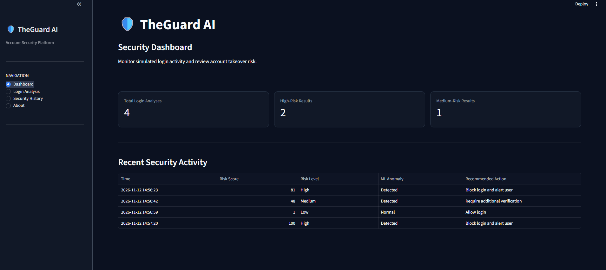
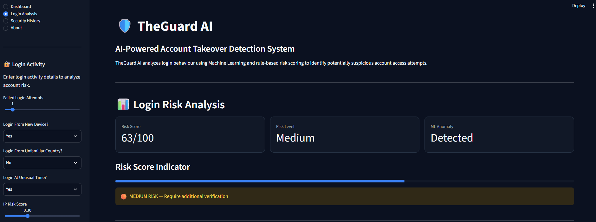
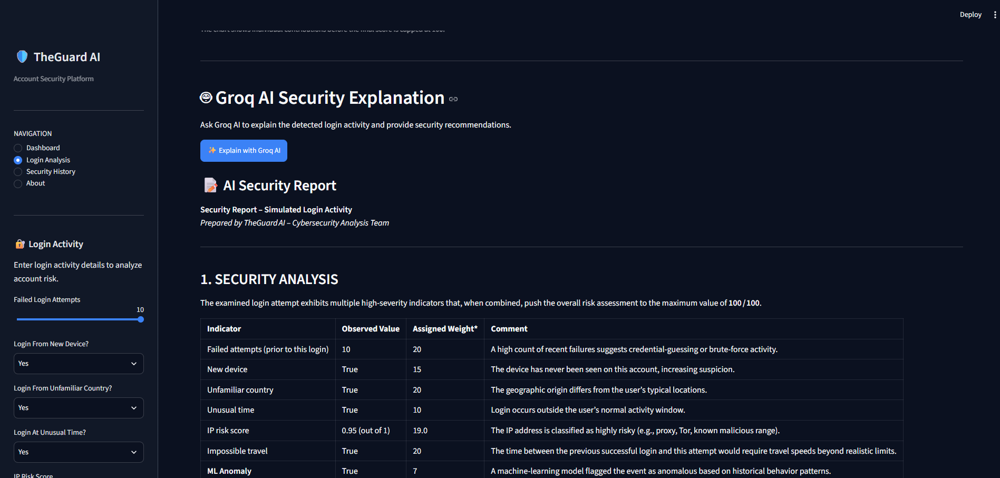
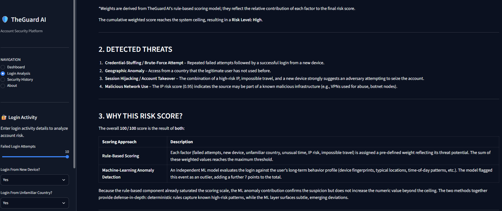
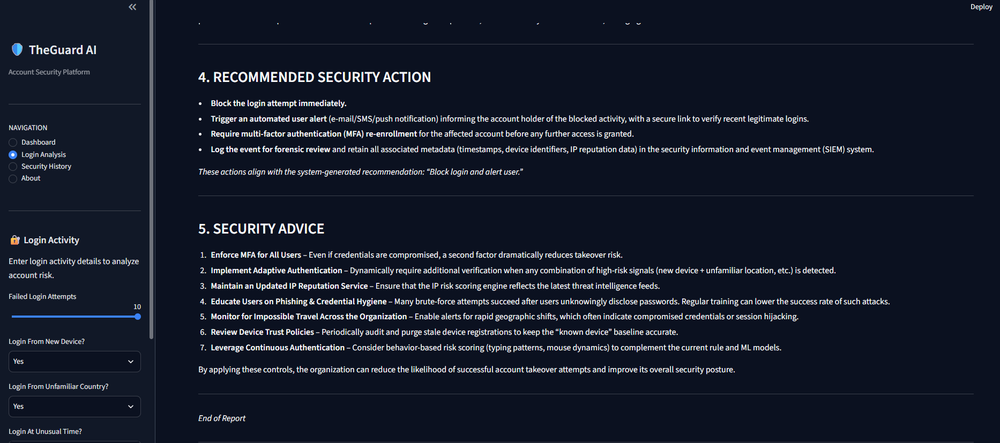

# 🛡️ TheGuard-AI

### AI-Powered Account Takeover Detection System

TheGuard-AI is a machine learning-powered security application designed to detect suspicious account activity, identify potential account takeover attempts, and provide intelligent risk analysis.

It combines anomaly detection, risk scoring, and AI-powered security explanations through an interactive Streamlit dashboard.

🚀 **[Live Demo – Try AccountGuard AI](https://theguard-ai-mm3kqxycxlxqkqhskuhkmy.streamlit.app/)**


## 🚀 Features

- **Machine Learning Detection:** Uses Isolation Forest to identify unusual activity.
- **Risk Scoring:** Evaluates suspicious activity and assigns risk levels.
- **AI Security Analysis:** Generates intelligent explanations of detected risks.
- **Interactive Dashboard:** Displays security insights through visualizations.
- **Security History:** Maintains a history of analyzed activities.
- **CSV Export:** Allows users to export analysis results.

## 🛠️ Technologies Used

- Python
- Streamlit
- Pandas
- NumPy
- Scikit-learn
- Plotly
- Groq API (AI Integration)
- OpenAI Python SDK
- Python-dotenv
  
## ⚙️ Installation and Setup

1. Clone the repository:

   ```bash
   git clone https://github.com/dhruv64termux/TheGuard-AI.git
   ```

2. Navigate to the project directory:

   ```bash
   cd TheGuard-AI
   ```

3. Install the required dependencies:

   ```bash
   pip install -r requirements.txt
   ```

4. Configure your API credentials in a local `.env` file using the variable expected by the application.

5. Run the application:

   ```bash
   streamlit run app.py
   ```

## 📊 Application Preview
### Main Dashboard


### Risk Detection

.png)


### AI Security Analysis




## 🔒 Security

- API credentials are stored in environment variables.
- Sensitive configuration files are excluded using `.gitignore`.
- Virtual environments and unnecessary Python cache files are excluded from version control.

## 👨‍💻 Author

**Dhruv Rajpurohit**

- GitHub: [@dhruv64termux](https://github.com/dhruv64termux)
- LinkedIn: [Dhruv Rajpurohit](https://www.linkedin.com/in/dhruv-rajpurohit-622836359/)

---

⭐ If you find this project interesting, consider giving the repository a star!

